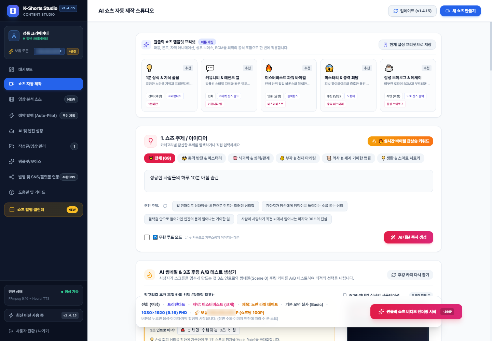
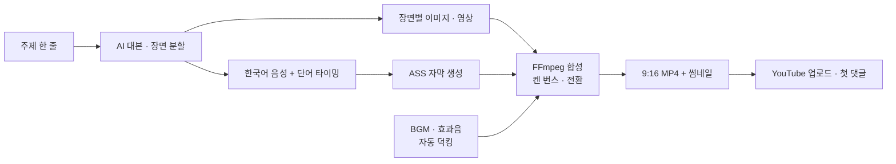

<div align="center">

# 🎬 K-Shorts Studio

**주제 한 줄 → 대본 · 한국어 음성 · 장면 이미지 · 자막 · 배경음악까지 9:16 쇼츠 한 편**

Windows 데스크톱 프로그램 · Electron + React + TypeScript · FFmpeg / libass


[English](README.md) · **한국어**


</div>

---

## 📌 목차

- [이런 영상이 나옵니다](#-이런-영상이-나옵니다)
- [화면 둘러보기](#-화면-둘러보기)
- [주요 기능](#-주요-기능)
- [제작 흐름](#-제작-흐름)
- [개발 실행](#-개발-실행)
- [설치 프로그램 빌드](#-설치-프로그램-빌드)
- [라이선스 키와 관리자 판](#-라이선스-키와-관리자-판)
- [데이터와 보안](#-데이터와-보안)
- [폴더 구조](#-폴더-구조)
- [라이선스](#-라이선스)

---

## 🎞 이런 영상이 나옵니다

API 키 없이 **무료 엔진만으로** 만든 실제 결과물에서 장면 3개를 뽑았습니다. 대본 *"아침 10분이 하루를 바꿉니다. 첫째, 물 한 잔을 마십니다. 둘째, 오늘 할 일 세 가지를 적습니다."* 를 넣고 1080×1920으로 렌더링했습니다.

<div align="center">


<sub>상단 제목 띠 · 3초 후킹 문구 · 문장별 장면 이미지 · 키워드 강조 자막</sub>
</div>

---

## 🖥 화면 둘러보기

<table>
<tr>
<td width="50%" valign="top">

### ✍️ 쇼츠 자동 제작
주제를 고르거나 직접 입력하면 대본, 후킹 문구, 썸네일 문구를 만들어 줍니다. 원클릭 프리셋으로 목소리, 자막, 화풍, 배경음악을 한 번에 맞춥니다.



</td>
<td width="50%" valign="top">

### 🎥 영상 분석 쇼츠
가지고 있는 가로 영상을 올리면 구간을 골라 9:16 쇼츠로 자릅니다. 원본 음성을 지우거나 유지하고, BGM과 자막 제목을 얹을 수 있습니다.


</td>
</tr>
<tr>
<td width="50%" valign="top">

### ⚡ 예약 발행 (Auto-Pilot)
정해진 시각과 주기에 맞춰 주제 기획부터 렌더링, YouTube 업로드, 첫 댓글까지 이어서 처리합니다. 이미 다룬 주제는 자동으로 피합니다.


</td>
<td width="50%" valign="top">

### 🎨 템플릿 · 보이스 프리셋
목소리, 자막 폰트, 자막 스타일, 화풍, 배경음악 조합을 프리셋으로 고릅니다. 한국어 음성 8종, 화풍 13종, 폰트 5종이 들어 있습니다.


</td>
</tr>
<tr>
<td colspan="2" valign="top">

### 🔑 AI · 엔진 설정
API 키는 모두 선택입니다. 키가 없으면 내장 규칙 대본과 무료 이미지 엔진으로 만들고, 키를 넣으면 Gemini · OpenAI · ElevenLabs · Pexels · Pixabay 등을 씁니다. GPU 인코더(NVENC · QSV)는 자동으로 감지합니다.

<div align="center"></div>

</td>
</tr>
</table>

---

## ✨ 주요 기능

| 영역 | 내용 |
|---|---|
| 🧠 **AI 대본** | Gemini 또는 OpenAI 키로 후킹 대본과 장면 분할을 만듭니다. 키가 없으면 내장 규칙으로 대본을 만듭니다. 한 문장이 한 장면이 되고, 최대 8장면입니다. |
| 🗣 **한국어 음성(TTS)** | Edge-TTS(무료)가 기본이고, ElevenLabs 키가 있으면 감정 표현 음성도 쓸 수 있습니다. Edge-TTS는 처음 쓸 때 자동 설치됩니다. |
| 🖼 **장면 이미지 · 영상** | 무료 이미지 생성(FLUX), Gemini Imagen, DALL·E 3, Fal, Stability, Pexels/Pixabay 스톡 사진·영상 중에서 고릅니다. 한국어 대본은 영문 시각 키워드로 바꿔 넘깁니다. |
| 💬 **자막 · 제목** | libass(ASS) 자막 스타일, 단어 단위 노래방 자막, 키워드 강조, 팝업 애니메이션, 상단 제목 띠, 3초 후킹 문구를 지원합니다. |
| 🎵 **배경음악 · 효과음** | 직접 합성한 로열티 프리 음원(`scripts/generate-bgm.js`, `scripts/generate-sfx.js`)을 씁니다. 음성이 나오는 구간에서는 배경음악 볼륨이 자동으로 줄어듭니다(사이드체인 덕킹). |
| ✂️ **롱폼 → 쇼츠** | 긴 영상에서 구간을 골라 9:16 클립으로 자릅니다. 원본 음성 유지·제거, BGM 믹싱을 지원합니다. |
| 📦 **대량 생성** | 엑셀이나 목록으로 여러 주제를 한 번에 만듭니다. 동시 렌더링 수를 고를 수 있습니다. |
| 🗓 **예약 · 자동 발행** | 시각·주기 예약, YouTube 자동 업로드와 첫 댓글, 발행 캘린더, 텔레그램 완료 알림을 지원합니다. |
| 🌏 **다국어** | 제목과 대본을 영어·일본어·스페인어로 옮겨 해외 채널용 문구를 만듭니다. |
| 🚀 **GPU 가속** | NVENC · QSV · AMF 인코더를 자동으로 찾고, 없으면 CPU(libx264)로 렌더링합니다. |

---

## 🔄 제작 흐름



---

## 🛠 개발 실행

**필요한 것:** Node.js 20 이상, Windows 10/11 64비트. 영상 합성은 `ffmpeg-static`이 들어 있어 따로 설치하지 않아도 됩니다.

```bash
npm install
npm run build   # 화면(Vite) + 메인 프로세스(Electron) 빌드
npm start       # 실행
```

| 명령 | 설명 |
|---|---|
| `npm run dev` | 개발 서버로 실행 (화면 수정 즉시 반영) |
| `node scripts/test-features-runtime.js` | 기능 시험 (377개 항목) |
| `npx tsc --noEmit` | 타입 검사 |

> 💡 Edge-TTS는 처음 쓸 때 사용자 폴더에 자동 설치됩니다. PC에 Python이 없으면 임베디드 Python도 함께 설치합니다.

---

## 📦 설치 프로그램 빌드

```bash
npm run dist:win   # release/ 에 NSIS 설치 파일과 .sha256 생성
```

`dist:win`은 항상 **구매자 판**(`KSHORTS_EDITION=buyer`)으로 빌드합니다. 구매자 판에는 관리자 로그인 코드가 들어가지 않습니다.

---

## 🔐 라이선스 키와 관리자 판

- **일반 로그인:** 라이선스 서버에서 키를 확인하고, 제작할 때마다 토큰을 차감합니다. 서버 응답은 Ed25519 서명으로 검증합니다.
- **이 저장소에 없는 것:** 서버 주소, 서버 코드, 서명 개인키. 서버 주소는 빌드할 때 `admin.local.json`의 `licenseServer` 또는 환경 변수 `KSHORTS_LICENSE_SERVER`에서 넣습니다. 값이 없으면 라이선스 로그인이 동작하지 않습니다.
- **관리자 로그인:** 소스에 검증값을 두지 않습니다. 빌드할 때 저장소에 올리지 않는 `admin.local.json` 또는 환경 변수 `KSHORTS_ADMIN_FNV`에서 읽고, 값이 없으면 관리자 로그인이 꺼집니다.

```json
// admin.local.json (저장소에 올리지 않음, .gitignore 등록됨)
{
  "adminKeyFnv": 0,
  "licenseServer": "https://your-license-server.example"
}
```

---

## 🛡 데이터와 보안

- 프로젝트와 설정은 사용자 데이터 폴더(Electron `userData`) 아래 `kshorts-data`에 저장됩니다.
- API 키, 토큰, 시크릿, 라이선스 키는 OS 보안 저장소(Windows DPAPI, Electron `safeStorage`)로 암호화해 저장합니다.
- 빌드본은 `webSecurity`와 `sandbox`를 켠 채로 실행합니다.
- 업데이트 설치 파일은 허용된 주소에서 받은 것만, SHA-256이 맞을 때만 설치합니다.
- 외부 도구(ffmpeg · ffprobe)는 셸을 거치지 않고 인자 배열로 실행합니다.

---

## 🗂 폴더 구조

```
kshorts-app/
├─ electron/          메인 프로세스 (렌더링 파이프라인, TTS, 이미지 엔진, 라이선스, 업데이트)
│  ├─ main.ts
│  └─ preload.ts
├─ src/               화면 (React + TypeScript + TailwindCSS)
│  ├─ components/     페이지와 모달
│  ├─ constants/      프리셋, 보이스, 자막 스타일
│  └─ hooks/
├─ public/
│  ├─ bgm/            로열티 프리 배경음악 (직접 합성)
│  └─ sfx/            효과음 (직접 합성)
├─ scripts/           빌드 · 시험 · 음원 생성 · 릴리스 스크립트
└─ docs/screenshots/  README 이미지
```

---

## 📄 라이선스

[MIT](LICENSE)
