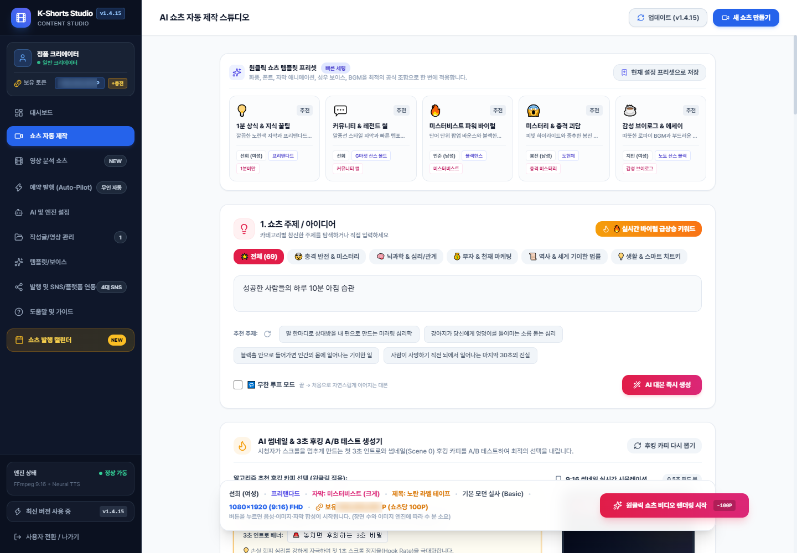
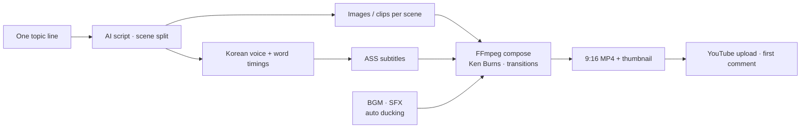

<div align="center">

# 🎬 K-Shorts Studio

**One topic line → script · Korean voice-over · scene images · subtitles · background music — a finished 9:16 short**

Windows desktop app · Electron + React + TypeScript · FFmpeg / libass


**English** · [한국어](README.ko.md)


</div>

> The app UI and the generated videos are in Korean. This README is in English; a Korean version is available at [README.ko.md](README.ko.md).

---

## 📌 Contents

- [Sample output](#-sample-output)
- [Screens](#-screens)
- [Features](#-features)
- [Pipeline](#-pipeline)
- [Development](#-development)
- [Building the installer](#-building-the-installer)
- [License keys and admin edition](#-license-keys-and-admin-edition)
- [Data and security](#-data-and-security)
- [Project layout](#-project-layout)
- [License](#-license)

---

## 🎞 Sample output

Three frames from a real render made **with free engines only (no API keys)**. The input script was *"Ten minutes in the morning change your day. First, drink a glass of water. Second, write down three things to do today."* (in Korean), rendered at 1080×1920.

<div align="center">


<sub>Top title bar · 3-second hook · one image per sentence · keyword-highlighted subtitles</sub>
</div>

---

## 🖥 Screens

<table>
<tr>
<td width="50%" valign="top">

### ✍️ Auto short creation
Pick or type a topic and get a script, hook lines and thumbnail copy. One-click presets set the voice, subtitles, art style and background music together.



</td>
<td width="50%" valign="top">

### 🎥 Video → Shorts
Upload a landscape video and cut selected segments into 9:16 shorts. Keep or remove the original audio and add BGM and a title.


</td>
</tr>
<tr>
<td width="50%" valign="top">

### ⚡ Scheduled publishing (Auto-Pilot)
At a set time and interval it plans a topic, renders, uploads to YouTube and posts the first comment. Topics already covered are skipped.


</td>
<td width="50%" valign="top">

### 🎨 Templates and voice presets
Choose combinations of voice, subtitle font, subtitle style, art style and BGM. Ships with 8 Korean voices, 13 art styles and 5 fonts.


</td>
</tr>
<tr>
<td colspan="2" valign="top">

### 🔑 AI and engine settings
All API keys are optional. Without keys the app uses a built-in rule-based script and a free image engine; with keys it can use Gemini, OpenAI, ElevenLabs, Pexels, Pixabay and more. GPU encoders (NVENC, QSV) are detected automatically.

<div align="center"></div>

</td>
</tr>
</table>

---

## ✨ Features

| Area | Details |
|---|---|
| 🧠 **AI script** | Hook script and scene split with a Gemini or OpenAI key; a built-in rule-based script without keys. One sentence becomes one scene, up to 8 scenes. |
| 🗣 **Korean TTS** | Edge-TTS (free) by default, ElevenLabs voices with a key. Edge-TTS installs itself on first use. |
| 🖼 **Scene images and video** | Free image generation (FLUX), Gemini Imagen, DALL·E 3, Fal, Stability, or Pexels/Pixabay stock photos and clips. Korean script lines are turned into English visual keywords first. |
| 💬 **Subtitles and titles** | libass (ASS) styles, word-level karaoke subtitles, keyword highlighting, pop-up animation, top title bar, 3-second hook intro. |
| 🎵 **Music and SFX** | Royalty-free tracks synthesized by the project (`scripts/generate-bgm.js`, `scripts/generate-sfx.js`). Music is ducked automatically under speech (sidechain compression). |
| ✂️ **Long-form → shorts** | Cut segments of a long video into 9:16 clips, keeping or removing the original audio and mixing BGM. |
| 📦 **Batch creation** | Create many topics at once from a spreadsheet or list, with a selectable number of parallel renders. |
| 🗓 **Scheduling and auto-publish** | Time/interval scheduling, YouTube auto-upload and first comment, publishing calendar, Telegram notifications. |
| 🌏 **Multilingual** | Translate titles and scripts into English, Japanese and Spanish for overseas channels. |
| 🚀 **GPU acceleration** | Detects NVENC, QSV and AMF encoders and falls back to CPU (libx264). |

---

## 🔄 Pipeline



---

## 🛠 Development

**Requirements:** Node.js 20+, Windows 10/11 64-bit. Video rendering uses the bundled `ffmpeg-static`, so no separate FFmpeg install is needed.

```bash
npm install
npm run build   # renderer (Vite) + main process (Electron)
npm start       # run
```

| Command | Description |
|---|---|
| `npm run dev` | Run with the dev server (live UI reload) |
| `node scripts/test-features-runtime.js` | Feature tests (377 checks) |
| `npx tsc --noEmit` | Type check |

> 💡 Edge-TTS is installed into the user folder on first use. If the PC has no Python, an embedded Python is installed as well.

---

## 📦 Building the installer

```bash
npm run dist:win   # writes the NSIS installer and a .sha256 file to release/
```

`dist:win` always builds the **buyer edition** (`KSHORTS_EDITION=buyer`), which contains no admin-login code.

---

## 🔐 License keys and admin edition

- **Regular login:** the license server checks the key and deducts tokens per video. Server responses are verified with Ed25519 signatures.
- **Not in this repository:** the server address, the server code and the signing private key. The server address is injected at build time from `licenseServer` in `admin.local.json` or the `KSHORTS_LICENSE_SERVER` environment variable. Without it, license login does not work.
- **Admin login:** no verification value lives in the source. It is read at build time from `admin.local.json` (not committed) or the `KSHORTS_ADMIN_FNV` environment variable; without it, admin login is disabled.

```json
// admin.local.json (not committed, listed in .gitignore)
{
  "adminKeyFnv": 0,
  "licenseServer": "https://your-license-server.example"
}
```

---

## 🛡 Data and security

- Projects and settings are stored under `kshorts-data` in the Electron `userData` folder.
- API keys, tokens, secrets and the license key are encrypted with the OS key store (Windows DPAPI via Electron `safeStorage`).
- Packaged builds run with `webSecurity` and `sandbox` enabled.
- Update installers are accepted only from allowed hosts and only when the SHA-256 matches.
- External tools (ffmpeg, ffprobe) are run with argument arrays, never through a shell.

---

## 🗂 Project layout

```
kshorts-app/
├─ electron/          main process (render pipeline, TTS, image engines, license, updates)
│  ├─ main.ts
│  └─ preload.ts
├─ src/               renderer (React + TypeScript + TailwindCSS)
│  ├─ components/     pages and modals
│  ├─ constants/      presets, voices, subtitle styles
│  └─ hooks/
├─ public/
│  ├─ bgm/            royalty-free background music (synthesized)
│  └─ sfx/            sound effects (synthesized)
├─ scripts/           build, test, audio generation and release scripts
└─ docs/screenshots/  README images
```

---

## 📄 License

[MIT](LICENSE)
